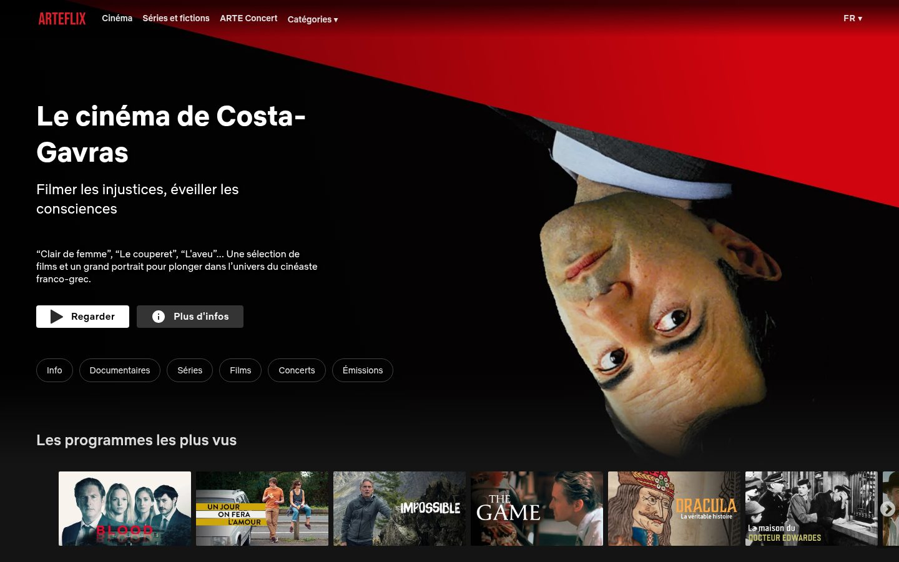

# Arteflix

[](https://github.com/kinooyume/arteflix/actions/workflows/ci.yml)
[](https://github.com/kinooyume/arteflix/actions/workflows/release.yml)

[](https://rescript-lang.org)
[](https://nextjs.org)
[](https://react.dev)
[](https://workers.cloudflare.com)
[](https://bun.sh)

A Netflix-style interface for Arte.tv, built almost entirely in ReScript.

**Live demo: [arteflix.kinoo.dev](https://arteflix.kinoo.dev)**



> A personal, non-commercial study project. Not affiliated with, endorsed by or connected to ARTE or Netflix. All programs, images and videos belong to [ARTE](https://www.arte.tv) and are loaded from their servers.


## What's this?

Take any Arte URL, swap the domain with `arteflix.kinoo.dev`, and you get the same content with a different UI. URLs stay 1:1 with arte.tv.

It started as an experiment to see how far I could push ReScript in a real project with minimal JS/TS escape hatches. Turns out, pretty far.

- rows of programs with lazy loading, per category and language (fr, de, en, es, it, pl)
- trailers on card hover and in the hero, fading in over the image, with a mute toggle
- series and collections open in a "more info" modal over the current page, with their real Arte URL; play starts episode 1
- video player with episode navigation and the live channel
- runs for €0: static files and a tiny Worker on Cloudflare's free plan


## Interesting problems

Arte has no public API. Everything here runs against their internal one, which changes without notice. A few things that had to be solved:

- **A `200` that lies.** Arte pages are assembled with ESI. When a fragment fails, its body (`429 - Too Many Requests`) is pasted as raw text inside the JSON while the status stays `200`. The app loads the page skeleton with `bypassESI=true`, then each zone on its own as it scrolls into view, and never caches an unparsed response.
- **CORS, but not everywhere.** Content endpoints allow any origin, so the browser calls Arte directly. Player and trailer configs only allow arte.tv, so they go through a ~100-line Cloudflare Worker.
- **Geoblocking through a proxy.** Arte saw the Worker's egress IP as British, so French-only content came back without streams. The Worker forwards the visitor's IP and keys its cache by country, so each visitor gets their own geoblocking, never someone else's.
- **Images that 429.** Arte's image CDN rate-limits per IP, but only on cache misses. Requesting exactly the sizes and query strings arte.tv itself requests keeps every image warm; a request queue turned out to be unnecessary.
- **A static Next.js app with dynamic URLs.** The site is a static export with a single page and a client-side router, so any Arte URL works without a server.
- **An API that drifts.** Decoding is schema-validated (sury) and tolerant: a broken zone is dropped, not the whole page. A verify script runs against the live domain after every deploy.


## Getting started

You need [Bun](https://bun.sh):

```bash
curl -fsSL https://bun.sh/install | bash
```

Then:

```bash
bun install
bun nx run arteflix:all:dev
```

Open http://localhost:3000. In dev, `/proxy/api/*` is forwarded to the deployed Worker (override with `ARTEFLIX_PROXY`).


## Commands

| Command | Action |
|---------|--------|
| `bun nx run arteflix:all:dev` | Dev server (ReScript + Next.js in watch mode) |
| `bun nx run arteflix:all:build` | Static export to `apps/arteflix/out` |
| `bun nx run arteflix-proxy:dev` | Serve the static export with the Worker, like production |
| `bun nx run arteflix:test` | App unit tests (Jest) |
| `bun nx run arte-api:test` | Arte API client tests |
| `bun nx run ui:test` | UI component tests |
| `bun nx run arteflix-proxy:test` | Worker tests |
| `bun nx run arteflix-e2e:e2e` | E2E tests (Playwright) |
| `bun nx run ui:storybook` | Storybook dev |
| `bun nx run arteflix:lint` | ESLint |


## Project layout

```
apps/
  arteflix/         # the app: static Next.js export + client-side router
  arteflix-proxy/   # Cloudflare Worker: serves the site, proxies player/trailer
  arteflix-e2e/     # e2e tests
libs/
  arte-api/         # Arte API client, schemas and URLs
  prefetch-arte/    # category routes generation
  shared/ui/        # component library + storybook
```


## Storybook

The UI library (`libs/shared/ui/`) has a full Storybook setup for developing components in isolation. All components are written in ReScript and have corresponding stories.

```bash
bun nx run ui:storybook
```

Components include cards, hero banners, episode lists, player, previews, the info modal, navigation, and tags — all the building blocks for the Netflix-style layout.


## CI/CD

```
feature/* → develop → main
              │         │
           CI tests   Release (GitHub Release + Cloudflare deploy)
```

Follows **Gitflow**: feature branches merge into `develop`, `develop` merges into `main` for releases.

- **feature → develop**: squash merge
- **develop → main**: merge commit

PRs to `develop` run build + unit tests + e2e. Pushing to `main` triggers a release: [cocogitto](https://docs.cocogitto.io/) bumps the version, generates a changelog, creates a GitHub release, then deploys the static site and its Worker to Cloudflare and checks the proxy online. After that, `main` is merged back into `develop`.

Commits must follow [Conventional Commits](https://www.conventionalcommits.org):
```
feat(ui): add trailer overlay
fix: locale detection for polish
```

**Secrets needed**: `GITHUB_TOKEN` (automatic), `CLOUDFLARE_API_TOKEN`, `CLOUDFLARE_ACCOUNT_ID`


## Deployment

The app is a static export (`apps/arteflix/out`). A Cloudflare Worker (`apps/arteflix-proxy`) on `arteflix.kinoo.dev` serves those files for free, falls back to `index.html` for any page URL, and only runs code for `/proxy/api/*`.

```bash
bun nx run arteflix:all:build      # static export
bun nx run arteflix-proxy:deploy   # deploy site + worker
bun nx run arteflix-proxy:verify   # check the proxy on the live domain
```


## Stack

**Core**: ReScript, Next.js 15 (static export), React 19

**UI**: Emotion, Framer Motion, React Aria, Video.js, React Slick

**Data**: SWR, sury (schema validation)

**Infra**: Cloudflare Workers, GitHub Actions

**Dev**: Bun, Nx, Jest, Playwright, Storybook, Cocogitto


## Known issues

- Nx doesn't play nice with `bun.lock` yet — https://github.com/nrwl/nx/issues/29494
- Some ReScript path resolution quirks with Nx, nothing major


## TODO

- TMDB integration for better metadata
- Offline support maybe?


## License

MIT for the code. Content, images and videos belong to ARTE.
